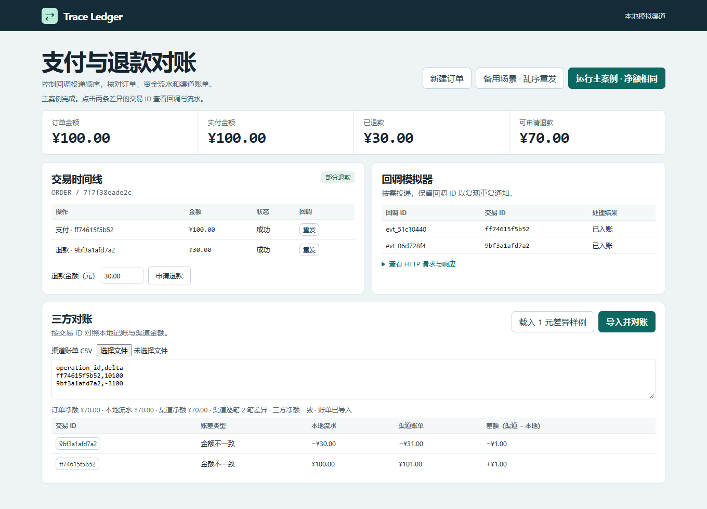

# Trace Ledger · 电商支付、退款与对账测试平台

**三方净额都是 ¥70.00，为什么仍有两笔错账？** 一笔 ¥100.00 的支付和一笔 ¥30.00 的退款，在渠道账单上分别变成了 ¥101.00 和 ¥31.00。汇总后仍是 ¥70.00，按交易 ID 比较才看得出两笔错账。



## 快速演示

在 Windows 安装 Python 3.13 和 Microsoft Edge。解压后在项目根目录打开 PowerShell，运行以下命令。

```powershell
py -3.13 -m venv .venv
.\.venv\Scripts\python -m pip install -r requirements.txt
.\.venv\Scripts\python app.py
```

打开 http://127.0.0.1:5051/ 并点击“运行主案例 · 净额相同”。先核对订单净额、本地流水和渠道净额均为 ¥70.00，再看差异表。

| 交易 | 本地流水 | 渠道账单 | 差额（渠道 − 本地） |
| --- | ---: | ---: | ---: |
| 支付 | ¥100.00 | ¥101.00 | +¥1.00 |
| 退款 | −¥30.00 | −¥31.00 | −¥1.00 |

点击两条差异的交易 ID，核对相应的回调与金额。渠道 CSV 使用预先设定的 10100 分和 −3100 分，只借用接口返回的交易 ID 做关联。再次点击“导入并对账”，同一账单显示为重复导入，差异仍为两笔。

面试时可以当场运行 `.\.venv\Scripts\python tools/verify_faults.py`。脚本在临时副本里分别跑正常实现和改成只比较净额的实现。正常实现通过，故意改错的版本实际返回零笔差异，被同一条测试拦下。[接口断言](tests/test_payments.py#L174) · [实验结果](reports/faults.json)

## 备用场景

点击“备用场景 · 乱序重发”，先申请退 30 元和 20 元，再先投递 20 元回调并重发一次。核对“重复事件”、累计退款 ¥50.00 和渠道账单的单笔差异。并发超退和流水写入回滚可直接运行相应的 [接口测试](tests/test_payments.py)。

手动操作时先点击支付行的“成功”，提交两笔退款，再选择回调顺序。点击“重发”会沿用原事件 ID。可以贴入或上传带有 `operation_id,delta` 表头的 CSV，金额单位是分，支付为正，退款为负。模拟数据存储在本地 SQLite。

## 从漏报到回归验证

用 SQL 将测试订单的实付和已退款分别从 100、30 元改成 99、29 元，资金流水与渠道账单保持正确。三个净额仍是 70 元，渠道与流水逐笔也一致。旧接口返回 200 并报告无订单异常，新回归用例在断言订单异常时失败。[修复前失败记录](reports/before-projection-fix.xml)

修复后按支付、退款两个方向分别核对订单汇总和资金流水。接口返回两个字段各自的原值和预期值，浏览器展示两个差异。这个用例同时断言三个净额相等、渠道逐笔差异为零，避免用其他错误掩盖复现条件。[修复后界面](reports/order-drift.png) · [接口测试](tests/test_payments.py)

对退款状态另做了 8 种确定性组合。退款回调有两种到达顺序，两笔退款各有成功或失败两种结果。每一步都断言 `已退款 + 待处理占额 + 可退额度 = 实付`，同时核对流水只包含成功交易。重复回调、超额 1 分和恰好耗尽额度也在序列里验证。[回调组合测试](tests/test_payments.py)

## 质量证据

| 风险 | 怎么测 | 预期与证据 |
| --- | --- | --- |
| 支付回调延迟或金额错误 | Requests 请求接口，核对回复和订单快照 | 回调成功前禁止退款，错误金额和冲突终态不入账 |
| 两笔退款乱序、重复回调 | pytest 按两种顺序回放，同一交易使用相同和不同事件 ID 重试，直接查询 SQLite | 累计退款恰好 5000 分，只写三条资金流水 |
| 并发重试与超额退款 | 用线程屏障同时发起真实 HTTP 请求 | 8 次回调只记账一次；已退 50 元后并发申请两笔 40 元，仅受理一笔 |
| 退款失败和数据库中途写入失败 | 失败回调后复查占额；用 SQLite 触发器模拟流水写入失败并重试 | 失败退款释放额度；写入故障时订单、流水与回调记录一起回滚 |
| 净额相同仍有账差 | 让支付与退款各相差 100 分且方向相反 | 精确断言交易 ID、本地金额、渠道金额与差异类型，并验证两条有符号差额 |
| 界面展示与报文一致 | Playwright 操作网页并读取真实浏览器 HAR | 核对状态、回调先后、相同请求体、去重回执、对账金额及移动宽度下的布局 |

三次定向故障实验分别跳过退款占额、渠道逐笔对账、订单与流水的分项比对。对应测试在正常版本通过，在三个故意改错的临时副本中都因业务断言失败。[故障实验结果](reports/faults.json)

本地完整回归 **24 项通过**。Locust 用 4 个虚拟用户执行 8 秒混合压测，每个流程创建订单、支付、部分退款并导入相符账单。此次完成 156 个对账流程，共 782 个 HTTP 请求，零失败，整体 P95 为 56 ms。自动验收要求至少完成 10 个流程、零失败、整体 P95 不超过 250 ms。这组数字描述本机冒烟运行。

```powershell
.\.venv\Scripts\python -m pytest -q --junitxml=reports/results.xml
.\.venv\Scripts\python tools/verify_faults.py
```

- 主案例和备用场景均有真实浏览器 HTTP 记录。导入 Edge 或 Chrome DevTools 的 Network 面板后，可核对 `/refunds`、`/callbacks` 和 `/statements`。[主案例 HAR](reports/equal-totals.har) · [乱序重发 HAR](reports/payment-session.har)
- [Locust HTML 报告](reports/load.html) 可以直接用浏览器打开。[流水线统计 CSV](reports/load_stats.csv)
- [pytest JUnit 报告](reports/results.xml) 保存每条用例的执行结果。

## 工具各自验证什么

| 工具 | 主要证据 |
| --- | --- |
| pytest + Requests | 真实 HTTP 接口的边界、组合与并发测试 |
| Postman + Newman | 可单独运行的接口验收集合，串联下单、退款、重复回调、对账、复导和超额拒绝。共 8 个请求、19 条断言通过，含 JSON Schema 校验。[集合](postman/payment-qa.postman_collection.json) · [Newman 报告](reports/newman.xml) |
| Playwright + Edge DevTools | Playwright 验证浏览器操作和实际报文，HAR 可导入 DevTools 逐笔核对。[主案例 HAR](reports/equal-totals.har) |
| SQLite | 直接核对入账流水，在隔离数据库里注入字段偏差和写入故障 |
| Locust | 并发跑真实交易闭环，以对账结果、失败率和 P95 作验收 |
| coverage.py | 测量后端语句、分支及未达行。再用故障对照确认关键断言能拦截逻辑回归。[覆盖报告](reports/coverage.json) |

服务启动后，可将集合导入 Postman，或用 Node.js 在项目目录运行 Newman。覆盖率命令独立测量 `app.py`。

本次 `app.py` 执行了 147/148 条语句和 33/34 个分支，未覆盖项是直接运行脚本时的开发服务器启动入口。浏览器 JavaScript 的覆盖率不在这个报告里。[coverage.py 分支覆盖说明](https://coverage.readthedocs.io/en/latest/branch.html) · [Newman 使用说明](https://github.com/postmanlabs/newman)

```powershell
npx.cmd --yes newman@6.2.3 run postman/payment-qa.postman_collection.json --bail -r cli,junit --reporter-junit-export reports/newman.xml
.\.venv\Scripts\python -m coverage run --branch --include=app.py -m pytest -q
.\.venv\Scripts\python -m coverage json -o reports/coverage.json app.py
```

## 实现范围与参考

固定订单金额、模拟渠道、SQLite 单机事务。退款申请先预占未退金额，成功回调再把占额转成退款流水。同一事件 ID 防重复投递，已完成交易防换事件 ID 再入账。对账同时校验订单净额、流水净额和按交易 ID 比较后的渠道差异。

回调场景参考 Stripe 关于乱序与重复投递的公开文档。页面、HTTP 和数据交叉核验参考 Cypress Real World App 的支付用例。浏览器抓包使用 Playwright 的 HAR 录制接口。[Stripe Webhooks](https://docs.stripe.com/webhooks) · [Cypress 支付测试源码](https://github.com/cypress-io/cypress-realworld-app/blob/develop/cypress/tests/ui/new-transaction.spec.ts) · [Playwright Python](https://github.com/microsoft/playwright-python)
